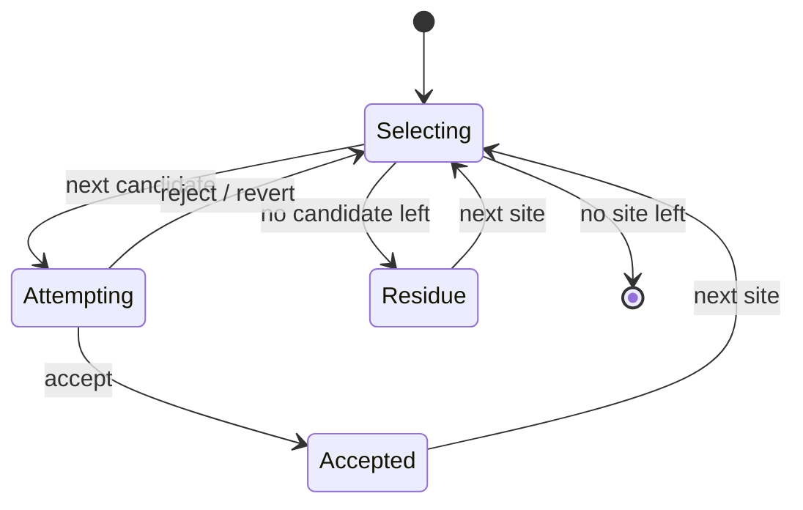

# The machine

This document is the specification of lean-mend's state machine. The Lean code
in `LeanMend/Spec` states the same definitions and theorems. If this document
and the Lean code disagree, the Lean code is correct and this document is
stale.

The machine has two levels (concept B8). Level 1 is the run over modules.
Level 2 refines the one composite state, `Mending`, into sites and candidates.

## Operands

All operands are typed Lean values. The shell parses them once, at the edge
(concept B2).

| Type | Fields | Source |
|---|---|---|
| `Toolchain` | the release name | `lean-toolchain` |
| `ModuleName` | a Lean `Name` | the import graph |
| `ModuleGraph` | modules and their imports, acyclic by construction | the probe reads the import headers |
| `Decl` | name, kind (`theorem`, `def`, `instance`, `abbrev`, `axiom`, other), statement hash, axioms | the probe |
| `Certificate` | toolchain, the set of built modules, a map from declaration name to `Decl` | the probe |
| `Diagnostic` | module, position, end position, severity, text | the messages of `lean --json`, from the probe's `elaborate` request (`docs/parallel.md` C5) |
| `Site` | module, the syntax node that contains the first error position, its region (`statement` or `body`), its diagnostic | the probe and the diagnostic |
| `FindingSite` | the finding's declaration, the cause constant, the target declaration nearest the cause, the tactic node (if any) that elaborates it | the evidence (`AxiomCause`), the certificate's module ownership, and the probe's `causeTactic` command |
| `ErrorClass` | a closed inductive type | computed by `classify` (pure) |
| `Rule` | name, entrenchment, provenance, class, syntax pattern, ordered candidate templates | rule files |
| `Candidate` | site, rule name, replacement syntax | `propose` (pure) |
| `AliasMap` | old name to final new name | the probe reads `@[deprecated]` under the new toolchain |

`ErrorClass` is closed. A diagnostic that matches no known class is the class
`unknown`. `unknown` is a legal class with no rules, so its sites go to the
residue. A new class is a change to the inductive type, and the type checker
then finds every function that must handle it (concept B4).

## Level 1: the run

The Lean type is `RunState` in `LeanMend/Core/Run.lean`. The transition
function is `RunState.step`.

```mermaid
stateDiagram-v2
  [*] --> idle
  idle --> baselined : baseline [no module failed]
  idle --> halted : baseline [a module failed] / baselineRed
  baselined --> built : bumped [alias map resolves] / every module blocked
  baselined --> halted : bumped [alias cycle] / aliasCycle
  built --> built : build [settled]
  built --> built : moduleBuild [a ready blocked module builds or fails; a mended module builds]
  built --> mending : diagnosed [module in frontier]
  mending --> mending : mend [Mending.step ok]
  mending --> built : mended [Mending.next = finish]
  built --> done : certificate [frontier empty, no finding]
  built --> repairing : certificate [frontier empty, an open finding's site has an unexhausted candidate]
  repairing --> repairing : repair [FindingMending.step ok]
  repairing --> built : repaired [FindingMending.next = finish]
  built --> awaiting : certificate [frontier empty, every open finding needs a card or is exhausted]
  built --> halted : certificate [a finding no card can accept] / invariantBroken
  awaiting --> awaiting : judgment [findings left]
  awaiting --> done : judgment [no finding left]
  done --> [*]
  halted --> [*]
```

Any observation that does not fit the state goes to `halted` with
`observationMismatch`.

| State | Holds |
|---|---|
| `idle` | the target path |
| `baselined` | the target path, the baseline certificate |
| `built` | the context (target, baseline, module graph, resolved alias map), and each module's status: `built`, `failing`, `blocked` or `residual` |
| `mending` | the context, the statuses, and one frontier module as a `Mending` value (level 2) |
| `repairing` | the context, the statuses, the after certificate, the open findings, and one repair-frontier module as a `FindingMending` value (level 3) |
| `awaiting` | the context, the after certificate, the residue list, the judgments, the open findings |
| `done` | the context, the after certificate, the residue list, the judgments |
| `halted` | the refusal |

A separate `Bumped` and `Certified` state are not needed: `bumped` goes to
`built` with every module blocked, and the first `build` observation sets the
real statuses. `certificate` runs `compare` in the same step.

A module is **blocked** when it fails and one of its imports does not build. A
**frontier** module fails and all of its imports build. A **residual** module
has one or more residue sites and no candidates left. The modules that import a
residual module stay blocked at the end; the residue list names them.

`Done` with an empty residue list means the whole target builds at the new
toolchain. `Done` with residue means lean-mend did all it can. Both are
successful ends. `Halted` is a refusal.

## Level 2: inside `Mending`

`Mending` (`LeanMend/Core/Mend.lean`) holds one frontier module, the count of
its unresolved errors, and a queue of its open sites. The head site holds its
remaining candidates, in rule order (concept C3). `Mending.next` tells the
shell what to do: attempt the head candidate, give up on the head site, or
finish.

The gluing invariant between the levels: the module in `Mending` is a frontier
module at level 1, and every accepted patch at level 2 is one commit on the
mend branch at level 1.

## Level 3: axiom repair

`certificate` can find a Violation finding whose cause has a rule. Level 3
repairs that finding, the same way Level 2 repairs a build error: it proposes
candidates, attempts one, and accepts it only on real progress. The unit is
not an error site. It is a `FindingSite`.

### The site of an axiom finding

A Violation finding names a declaration `d` and an `AxiomCause`
(`docs/verification.md` § What a card explains). The cause's `path` runs from
`d` to the differing axiom, declaration first. Call a constant on the path
**owned** when its module belongs to the target, not to Lean core or a
dependency package (the same test `collectEvidence` already uses for `Owner`,
`docs/verification.md` § The data at each toolchain).

Call a constant on the path a **generated auxiliary** when Lean, not a
person, named it: a name component that starts with `_`
(`List.find?_congr._proof_1_1`), or with `match_`
(`allocationSizes.match_1`). Such a name gives its place to the declaration
that owns it, the same rule `pickCause` already applies to the cause (§ The
cause in `docs/verification.md`).

The site is the owned constant on `path` nearest the cause, walking from the
axiom toward the declaration, each constant taken under its owner when it is
a generated auxiliary. Formally: let `k` be the index of `pickCause`'s
result on `path`. The site is `path[i]`'s owner, for the largest `i < k`
with `path[i]` owned, or `path[0]`'s owner (`d` itself has none, so the site
is `d`) when no such `i` exists. `d` is always owned, so the site always
exists.

This definition gives one target declaration a finding can reach by a chain
of calls through the target's own code before it meets the library constant
that differs. Editing that declaration's proof removes the finding for `d`
and for every other open finding whose path reaches the same site: EquiVM run
10's 38 G1 cards all resolve to one site,
`Reasoning.Theory.selectorDispatchMsg_eq_dispatchList`, because every path
from an importing module's own declaration runs through it before it reaches
Mathlib's `List.find?_congr` (`.scratch/axiom-fix/edits.md` § Groups, G1).

EquiVM run 10's single G3 card needs the owner rule
(`.scratch/axiom-fix/edits.md` § Edit E3). Lean compiles `allocationSizes`'s
own `match` into a generated matcher, `allocationSizes.match_1`, the cause.
The path to it runs through a well-founded-recursion helper,
`allocationSizes._f`, also generated. Neither name has a source declaration
of its own, so `locate` (`LeanMend/Shell/Target.lean`) finds no place to
edit for either. The owner rule gives both their place to `allocationSizes`,
the declaration Edit E3 changed, which does have one.

A `FindingSite` groups every open finding whose site is the same declaration
and whose cause constant is the same (`groupCauses` already computes this
grouping, `docs/verification.md` § Groups and judging; a `FindingSite` adds
the site declaration to that key).

### The tactic inside the site

A candidate still needs a syntax node (`docs/rules.md` § The rule format).
The probe's `node` command finds one from a diagnostic's byte offset
(`docs/parallel.md` C3); a `FindingSite` has no diagnostic. A new probe
command, `causeTactic <file> <declStart> <constant>`, finds it instead: it
elaborates the declaration's body, walks its `TacticInfo` nodes in source
order (the same `foldInfoM` walk `proofs` already uses, `probe/Probe.lean`
`proofRanges`), and for each step computes `Expr.getUsedConstants` on the
term the step adds to the proof. The reply is the first step, in source
order, whose set holds `constant`. For
`selectorDispatchMsg_eq_dispatchList` this is its first tactic,
`simp only [selectorDispatchMsg]` (G1); `dsimp` in its place keeps the same
unfold and adds no congruence lemma, because `dsimp` only unfolds, it never
closes a step with a lemma.

A site with no such tactic (the cause enters through the statement, or
through no tactic the probe can single out) gets no node, so no rule that
needs one proposes a candidate for it, the same rule a diagnostic site with
no node already follows (`probe/Probe.lean` § `nodeAt`): no node, no
candidate, never an error.

### FindingMending

`FindingMending` (sibling of `Mending`, `LeanMend/Core/Mend.lean`) holds one
repair-frontier module — a module that owns the site of at least one open
finding — the count of its open finding-sites, and a queue of their
candidates, in rule order. Its shape follows `Mending`: the head site holds
what candidates are left, never what was tried (concept B6). A `Fleet`-shaped
collection holds one `FindingMending` per repair-frontier module, exactly as
`Fleet` does for `Mending` (`docs/parallel.md` § Level 2).

The gluing invariant: a repair-frontier module in `repairing` is a module
that owns at least one open finding's site, and every accepted patch is one
commit on the mend branch, exactly as Level 2's invariant states it.

### Acceptance

An attempt rebuilds the site's module only. `certificate` then runs again,
scoped to that module, and `compare` runs again over its declarations. The
check for the importers depends on what the edit can change:

- **The edit is inside a proof only** (the body of a `theorem` or `lemma`, or
  a proof sub-term of a `def` body, by the proof-term rule of § What a card
  explains in `verification.md`). The edited declaration keeps its statement
  (the invariant's first part), and an importer refers to it only through
  that statement: a proof is irrelevant to every term that uses it. So no
  importer's elaborated term changes, and no importer can get a new build
  error. The importers' axiom sets are computed without a rebuild: walk the
  current build's constant graph (`axEdges`, `probe/Probe.lean`), take each
  constant's own measured edges, substitute the rebuilt module's new axiom
  sets for its constants, and take the unions again. An importer that picks up
  an axiom by its own tactics still shows it, because the walk reads that
  importer's own edges from the current build. `.scratch/axiom-fix/edits.md`
  § Edit E1 measured this on 31 cross-module cards: the walk gave
  `[Quot.sound, propext]` for all 31, and the control walk without the
  substitution gave `Classical.choice` for all 31.
- **The edit can change what a declaration computes** (a `def` body outside a
  proof, or an option such as `backward.match.sparseCases` that changes a
  compiled `match`). An importer that reduces the edited declaration (by
  `decide`, `rfl` or `native_decide`) can then elaborate differently. Only this
  case rebuilds importers, and only the importers that use a changed
  declaration (from the constant graph), not every module that imports the
  site's module.

Accept only when:

1. every declaration whose finding named this site now has its baseline
   axiom set, in the site's module and in every importer, by the walk or by
   the rebuild above;
2. no declaration of the site's module, and no rebuilt importer, has a new
   finding of any kind (reusing `compare` unchanged: a repair that fixes one
   axiom but adds another, or changes a statement hash, or changes a `def`'s
   body outside a proof, is rejected, never half accepted);
3. the site's module, and every rebuilt importer, still builds with no new
   error.

Cost, measured on EquiVM's G1 group: `Reasoning/Dispatch.lean` elaborates in
33.2 s (1.94 GiB peak). Its 84 direct importers each elaborate in 10 to 13 s
(2.3 to 2.5 GiB peak), on a loaded 32-core host
(`EquiVM/.scratch/mend-target`, 2026-11-07). A rebuild of every importer costs
that for each candidate, about 16 minutes serial; the edit E1 is proof-only,
so the check above costs one module's elaboration plus the walk (decision
D15).

### A def, instance or abbrev site

A site may be a `def`, `instance` or `abbrev` rather than a `theorem`. Its
`kind.computes = true`, so the invariant's third part needs the body
unchanged or a card (§ The invariant, part 3). When the accepted edit's
changed bytes lie wholly inside a proof sub-term of the body — the same test
`bodyChange` already computes for a Behavior card, from the info trees
(`docs/verification.md` § The body change) — the edit cannot change what the
`def` computes: proof irrelevance means any two proofs of the same
proposition are interchangeable. `FindingMending`'s accept step then writes
an already-accepted Behavior card (status `held`, evidence the proof-only
test), with no person needed, the same conclusion EquiVM's own c-1 and c-2
Behavior cards reached by hand (`docs/verification.md` § Behavior cards c-1
and c-2 used an `rfl` check across both toolchains; the proof-only test
proves the same fact from the syntax, without running the definition). A site
whose changed bytes touch the data component still needs a person's card, as
today (decision D16).

## Transitions

Every transition is a pure function in `LeanMend/Core`. Its input is the state
and an observation that the shell made. Its output is the next state, or a
refusal (concept B5). The shell makes the observation and records it in the
ledger before the transition runs.

| Observation | State | Guard | Next state or refusal |
|---|---|---|---|
| `baseline cert failing` | `idle` | `failing` is empty | `baselined`; else `baselineRed` (lean-mend does not mend a target that was already broken) |
| `bumped mods aliases` | `baselined` | the alias map resolves | `built`; else `aliasCycle` |
| `build st` | `built` | `Settled`: no closed module changed status | `built`; else `observationMismatch` |
| `moduleBuild module s` | `built` | `module` is `blocked` and in `ready` (open, every import builds), and `s` is `built` or `failing`; or `module` is `built` and `s` is `built` | `built`, with `module` set to `s`; else `observationMismatch` |
| `diagnosed module sites` | `built` | the module is in the frontier | `mending` |
| `mend (rebuilt e lint sites)` | `mending` | the head site has a candidate | `e` is the module's whole error count, residue included. Accept if `e` is below unresolved plus residue, the candidate is clean, `lint` is 0, and `sites` (without residue sites) fit `e`; else reject |
| `mend unparsable` | `mending` | the head site has a candidate | reject |
| `mend gaveUp` | `mending` | the head site has no candidate | the head site becomes residue |
| `mended` | `mending` | `Mending.next = finish` | `built`, with the module `built` or `residual` |
| `certificate after` | `built` | the frontier is empty | `compare`: `done`, `repairing` [a finding's unexhausted site exists], `awaiting` or `invariantBroken` |
| `repair module o` | `repairing` | `module` is a repair-frontier module in the fleet | `repairing` (`FindingMending.step` routes `o`, § Level 3); else `observationMismatch` |
| `repaired module` | `repairing` | `FindingMending.next = finish` for `module` | `built` when every repair-frontier module is done; else `repairing` |
| `judgment j` | `awaiting` | `j` is about an open finding | `compare` again; else `unknownCard` |

A dependency package that does not build (`dependencyRed`) and a second
wall-clock timeout (`hostTimeout`) are refusals the shell raises before it
makes an observation.

The shell takes a certificate only when the probe gives a row for each
declaration that the certificate selects. When the probe cannot give one, the
shell stops the run with the typed error `DeclUnread` before the `baseline`
or `certificate` observation. The error names the module and the
declaration (`docs/verification.md` § The certificate). Without the row,
`compare` would not check the declaration.

The structural checks on an attempt (concept C2, structural):

1. The edit is inside the body region of its declaration, or it is an alias
   rename, or it is an insertion before the declaration's command
   (`set_option maxHeartbeats N in`). The one statement edit is
   `typeAnnotation` (decision D11), proposed only with `--annotate-binders`.
   `followStatement` (decision D12) is proposed only with
   `--follow-definition-changes`.
2. The candidate adds none of the tokens in `forbiddenTokens`: `sorry`,
   `admit`, `axiom`, `native_decide`, `implemented_by`, `extern`, `unsafe`,
   `opaque`, and no declaration keyword (`def`, `theorem`, `lemma`,
   `instance`, `abbrev`, `inductive`, `structure`, `class`, `example`,
   `mutual`, `attribute`): decision D10. The check reads the identifier runs
   that the edit adds: those in the replacement and not in the bytes it
   replaces (`addedTokens`, `Candidate.clean`). A token that the node already
   holds stays allowed. EquiVM run 5 rejected `simpaToExact` at the 47
   `Tests/Pipeline/Vault/Dispatch.lean` sites, because each `simpa` term
   already held `native_decide`.
3. The candidate's rule passed the vacuity check when it was loaded
   (concept C9).
4. Lean reports no linter warning (message kind `linter.*`) inside the
   replaced bytes. `lint` in the observation is that count. The kind is the
   same in v4.29.0, v4.33.1 and v4.35.0, and the warnings come from the same
   elaboration that counts the errors. Only warnings inside the edit
   count: a declaration that had an error was not linted, so its older
   warnings can appear after any repair. The replaced bytes are the whole
   tactic node, so an argument that was already unused in that tactic also
   blocks the candidate. That is deliberate: the repaired tactic must be clean
   as a whole. `Accepted` carries `lintFree`, and `branchSound` states it.

   Lean's warnings also make the better candidate. If a candidate clears the
   error and every warning in its bytes is an unused simp argument
   (`linter.unusedSimpArgs` names it), `Mending.step` replaces the head
   candidate with the same edit without those arguments (`dropSimpArgs`,
   which keeps the layout), and the shell attempts it next. The flagged
   candidate itself is never accepted; if the cleaned one fails, it is
   rejected like any other candidate.
5. The edit made progress, by two checks (`Mending.step`).

   - **Position.** The Core sorts the open sites by their position:
     declaration index, then bytes to the declaration's end (`Site.reach`).
     It does not use Lean's message order. The earliest open position must
     move strictly toward the end of the file (`docs/parallel.md` X3).
   - **Cause.** The edit must remove one instance of the head's failure, and
     every failure it adds must be in the attempted site's declaration, after
     the bytes the edit changed (`Candidate.leavesOnlyLater`, X4). A failure
     is added when it occurs more often after the edit than before
     (`Site.sameAs`, counted, so two identical failures stay distinct).

   An edit that removes the head's error lets Lean check further into the
   declaration, so it can expose any number of later errors there. Lean
   checks each declaration on its own, so an error in another declaration is
   never exposed: it is a break that the edit caused. An error inside the
   edit's own bytes is the edit's own failure. The position check alone
   admits both: in EVMLean run 21, `closeBullet "omega"` failed inside its
   own bytes in `AccountLocality`, and the shorter text made the error look
   later. The cause check rejects that edit. Example of a correct exposure:
   EVMLean `ReturnDataBound` 2528, where the `RBSet` move exposes an error at
   2552.

## The invariant

This is the one invariant of the machine, law LM1 in [laws.md](laws.md). It is
stated first, in `LeanMend/Spec/Invariant.lean` (concept B3).

> **No harm.** For every declaration `d` in the baseline certificate whose
> module is built in the after certificate:
>
> 1. the source statement of `d` at the new toolchain equals the source
>    statement at the old toolchain, after the alias map is applied, or `d`
>    is in the after certificate's `followed` list (decision D12); and
> 2. the axioms of `d` equal the baseline axioms of `d`, or a closed card
>    accepts the difference; and
> 3. if `d` is a `def`, `instance` or `abbrev` and its body changed, a closed
>    card accepts the change.
>
> And every commit on the mend branch is an accepted patch in the ledger.

Part 1 holds by construction: `EditTarget` has no constructor for a statement
region. `compare` still checks it, and a changed statement halts the run with
`invariantBroken`. Parts 2 and 3 hold by verification, at `compare`, and the
theorem `compare_nil` proves that no finding means `NoHarm`. The last part
holds by construction: `Accepted` carries its evidence, and the theorem
`branchSound` states it.

The invariant is also checked at the module level. This check is designed and
not yet in the Lean code. When a
frontier module first builds, the shell takes that module's certificate. If
part 1 or part 2 fails for that module, the machine reverts every patch in the
module and marks it residual with the refusal `InvariantBroken`. An axiom
difference that an upstream change caused (a library lemma now uses
`Classical.choice`) is not a fault of lean-mend. It still needs a card,
because only a person can decide that the difference is acceptable.

## Termination

The run stops. The measure is lexicographic, over:

1. the number of modules that are `failing` or `blocked`, and not `residual`,
   then the number of modules that are `blocked`;
2. inside `Mending`, the number of error sites in the module that are not
   marked residue;
3. the head site's `Site.reach`, its distance in bytes to the end of its
   declaration;
4. the number of candidates left at the head site;
5. the length of the head candidate's replacement. A cleaning by Lean's hint
   keeps items 2 to 4 and shortens it (`Mending.refine_measure`).

`accept` with a fall in the module's whole error count `e` reduces item 2; the
new unresolved count is `e` minus the residue. An exposing `accept` keeps item
2 and reduces item 3: an edit changes no byte after itself, so the exposed
error's distance to the declaration's end is smaller. `reject` reduces item 4.
`Residue` removes a site, so it reduces item 2. A module leaves `Mending` built
or residual, so item 1 falls at `mended`. A blocked module becomes failing or
built only at a `moduleBuild`, when every module it imports builds: that
never raises the open count, and it lowers the blocked count.

The decrease is proved in `LeanMend/Spec/Termination.lean`:

| Theorem | Statement |
|---|---|
| `Mending.step_measure` | every successful `Mending.step` lowers (items 2 to 5) lexicographically |
| `openCount_finish` | leaving `Mending` with the module `built` or `residual` lowers item 1 |
| `openCount_settled` | a settled `build` never raises item 1 |
| `frontier_open` | a frontier module is open, so `openCount_finish` applies to it |
| `RunState.moduleBuilt_settled` | a `moduleBuild` keeps every closed module as it was, so it never raises item 1 |
| `blockedCount_moduleBuilt` | a `moduleBuild` that unblocks a module lowers the blocked count |

There is no retry cap and no iteration limit (concept D5).

### Level 3

Level 3 is a separate phase, after Level 1 and Level 2 both reach a fixpoint
(the frontier is empty, by `certificate`'s own guard). Its measure does not
extend theirs; it is proved to decrease on its own, exactly as Level 2's
measure is proved independent of Level 1's.

`Context` gains `exhaustedSites : List String`: the site declarations whose
candidate list ran out in an earlier repair round. `certificate`'s guard for
`repairing` excludes them, so a site that already gave up is never diagnosed
for a candidate again, even across repair rounds — the same B6 property
Level 2 already has within one module's `Mending`.

The measure is `(openFindingCount, candidatesLeft)`, lexicographic:

1. the number of open findings whose site is not in `exhaustedSites`;
2. the candidates left, summed over every open, unexhausted site's head.

An accepted repair closes the finding of every open finding whose site is
the accepted site (`compare` stops reporting them once the axioms match
baseline, by construction: acceptance condition 1 of § Acceptance is exactly
this), so it lowers item 1. A gave-up site leaves the open-site list for
`exhaustedSites` too, so it also lowers item 1, by item 1's own clause
("whose site is not in `exhaustedSites`"): a gave-up finding still needs a
card, so it is not resolved, but it stops counting as open once its site is
no longer diagnosed. Both an accept and a giveUp remove a whole site from
the open-site list, and a site always closes at least one finding
(`groupFindingSites` never builds an empty group), so item 1 falls by at
least one on either transition. A rejected candidate drops the head of the
site's candidate list, lowering item 2 with item 1 unchanged, the same way
`Mending.reject_measure` does.

## Timeouts

A timeout is an error class, never a skip (brief item 8).

- **`heartbeat`** is deterministic: Lean counts its own allocations. Its rules
  may add `set_option maxHeartbeats N in` before the declaration. This edit is
  outside the statement region. The candidate list raises N in fixed steps
  that the rule states. A heartbeat repair is flagged on the run report,
  because a larger budget can hide a performance regression upstream.
- **`wallclock`** is contention on the host. It is not a fault of the target,
  so no rule edits the target for it. The shell builds the module again with
  no other build running. A second wall-clock timeout is the refusal
  `HostTimeout`, and the run stops. This is one controlled re-run under a
  changed condition, not a retry loop.

## What the ledger records

Each transition appends one ledger entry before the shell acts on its result:
the transition name, the observation, the verdict, and for `judge` the
judgment with its author. The state at any point is the fold of the ledger
over the initial state (concept B6). A crashed run continues by replaying the
ledger and comparing the result with the mend branch in git (concept D1).
