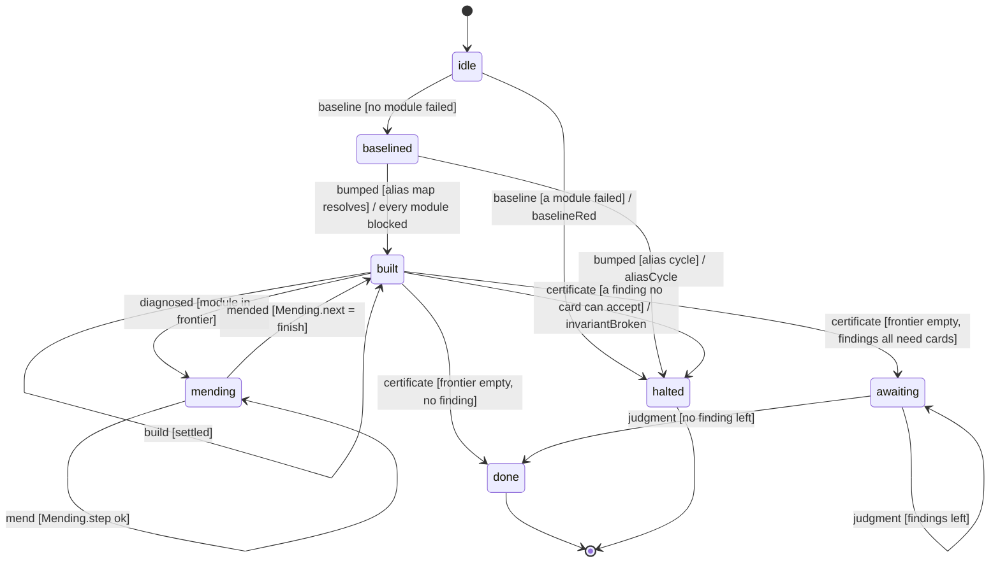
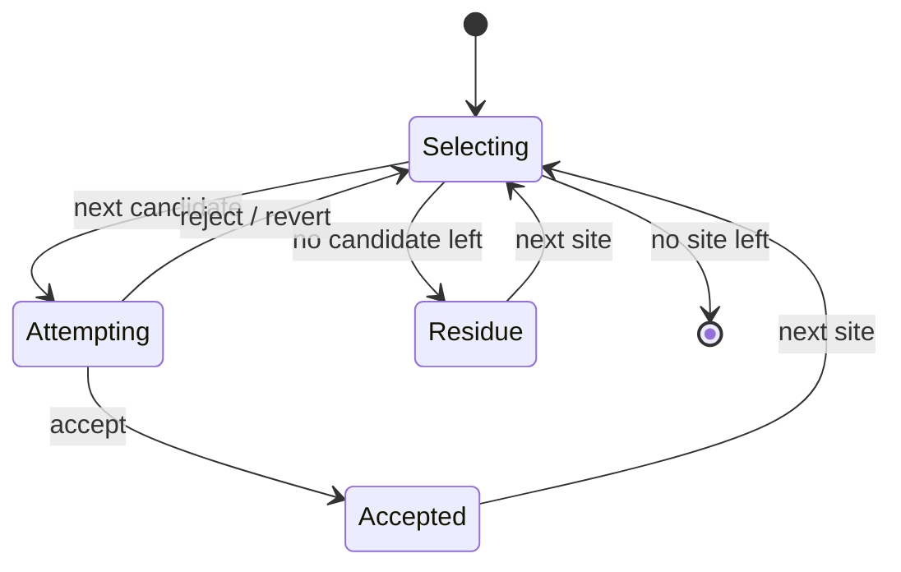

# The machine

This document is the specification of lean-mend's state machine. The Lean code
in `LeanMend/Spec` states the same definitions and theorems. If this document
and the Lean code disagree, the Lean code is correct and this document is
stale.

The machine has two levels (concept B8). Level 1 is the run over modules.
Level 2 refines the one composite state, `Mending`, into sites and candidates.

## Operands

All operands are typed Lean values. The shell parses them once, at the edge
(concept B2).

| Type | Fields | Source |
|---|---|---|
| `Toolchain` | the release name | `lean-toolchain` |
| `ModuleName` | a Lean `Name` | the import graph |
| `ModuleGraph` | modules and their imports, acyclic by construction | the probe reads the import headers |
| `Decl` | name, kind (`theorem`, `def`, `instance`, `abbrev`, `axiom`, other), statement hash, axioms | the probe |
| `Certificate` | toolchain, the set of built modules, a map from declaration name to `Decl` | the probe |
| `Diagnostic` | module, position, end position, severity, text | `lean --json` |
| `Site` | module, the syntax node that contains the first error position, its region (`statement` or `body`), its diagnostic | the probe and the diagnostic |
| `ErrorClass` | a closed inductive type | computed by `classify` (pure) |
| `Rule` | name, entrenchment, provenance, class, syntax pattern, ordered candidate templates | rule files |
| `Candidate` | site, rule name, replacement syntax | `propose` (pure) |
| `AliasMap` | old name to final new name | the probe reads `@[deprecated]` under the new toolchain |

`ErrorClass` is closed. A diagnostic that matches no known class is the class
`unknown`. `unknown` is a legal class with no rules, so its sites go to the
residue. A new class is a change to the inductive type, and the type checker
then finds every function that must handle it (concept B4).

## Level 1: the run

The Lean type is `RunState` in `LeanMend/Core/Run.lean`. The transition
function is `RunState.step`.

Any observation that does not fit the state goes to `halted` with
`observationMismatch`.

| State | Holds |
|---|---|
| `idle` | the target path |
| `baselined` | the target path, the baseline certificate |
| `built` | the context (target, baseline, module graph, resolved alias map), and each module's status: `built`, `failing`, `blocked` or `residual` |
| `mending` | the context, the statuses, and one frontier module as a `Mending` value (level 2) |
| `awaiting` | the context, the after certificate, the residue list, the judgments, the open findings |
| `done` | the context, the after certificate, the residue list, the judgments |
| `halted` | the refusal |

A separate `Bumped` and `Certified` state are not needed: `bumped` goes to
`built` with every module blocked, and the first `build` observation sets the
real statuses. `certificate` runs `compare` in the same step.

A module is **blocked** when it fails and one of its imports does not build. A
**frontier** module fails and all of its imports build. A **residual** module
has one or more residue sites and no candidates left. The modules that import a
residual module stay blocked at the end; the residue list names them.

`Done` with an empty residue list means the whole target builds at the new
toolchain. `Done` with residue means lean-mend did all it can. Both are
successful ends. `Halted` is a refusal.

## Level 2: inside `Mending`

`Mending` (`LeanMend/Core/Mend.lean`) holds one frontier module, the count of
its unresolved errors, and a queue of its open sites. The head site holds its
remaining candidates, in rule order (concept C3). `Mending.next` tells the
shell what to do: attempt the head candidate, give up on the head site, or
finish.

The gluing invariant between the levels: the module in `Mending` is a frontier
module at level 1, and every accepted patch at level 2 is one commit on the
mend branch at level 1.

## Transitions

Every transition is a pure function in `LeanMend/Core`. Its input is the state
and an observation that the shell made. Its output is the next state, or a
refusal (concept B5). The shell makes the observation and records it in the
ledger before the transition runs.

| Observation | State | Guard | Next state or refusal |
|---|---|---|---|
| `baseline cert failing` | `idle` | `failing` is empty | `baselined`; else `baselineRed` (lean-mend does not mend a target that was already broken) |
| `bumped mods aliases` | `baselined` | the alias map resolves | `built`; else `aliasCycle` |
| `build st` | `built` | `Settled`: no closed module changed status | `built`; else `observationMismatch` |
| `diagnosed module sites` | `built` | the module is in the frontier | `mending` |
| `mend (rebuilt e lint sites)` | `mending` | the head site has a candidate | `e` is the module's whole error count, residue included. Accept if `e` is below unresolved plus residue, the candidate is clean, `lint` is 0, and `sites` (without residue sites) fit `e`; else reject |
| `mend unparsable` | `mending` | the head site has a candidate | reject |
| `mend gaveUp` | `mending` | the head site has no candidate | the head site becomes residue |
| `mended` | `mending` | `Mending.next = finish` | `built`, with the module `built` or `residual` |
| `certificate after` | `built` | the frontier is empty | `compare`: `done`, `awaiting` or `invariantBroken` |
| `judgment j` | `awaiting` | `j` is about an open finding | `compare` again; else `unknownCard` |

A dependency package that does not build (`dependencyRed`) and a second
wall-clock timeout (`hostTimeout`) are refusals the shell raises before it
makes an observation.

The structural checks on an attempt (concept C2, structural):

1. The edit is inside the body region of its declaration, or it is an alias
   rename, or it is an insertion before the declaration's command
   (`set_option maxHeartbeats N in`). The one statement edit is
   `typeAnnotation` (decision D11), proposed only with `--annotate-binders`.
   `followStatement` (decision D12) is proposed only with
   `--follow-definition-changes`.
2. The candidate adds none of the tokens in `forbiddenTokens`: `sorry`,
   `admit`, `axiom`, `native_decide`, `implemented_by`, `extern`, `unsafe`,
   `opaque`, and no declaration keyword (`def`, `theorem`, `lemma`,
   `instance`, `abbrev`, `inductive`, `structure`, `class`, `example`,
   `mutual`, `attribute`): decision D10. The check reads the identifier runs
   that the edit adds: those in the replacement and not in the bytes it
   replaces (`addedTokens`, `Candidate.clean`). A token that the node already
   holds stays allowed. EquiVM run 5 rejected `simpaToExact` at the 47
   `Tests/Pipeline/Vault/Dispatch.lean` sites, because each `simpa` term
   already held `native_decide`.
3. The candidate's rule passed the vacuity check when it was loaded
   (concept C9).
4. Lean reports no linter warning (message kind `linter.*`) inside the
   replaced bytes. `lint` in the observation is that count. The kind is the
   same in v4.29.0, v4.33.1 and v4.35.0, and the warnings come from the same
   `lean --json` run that counts the errors. Only warnings inside the edit
   count: a declaration that had an error was not linted, so its older
   warnings can appear after any repair. The replaced bytes are the whole
   tactic node, so an argument that was already unused in that tactic also
   blocks the candidate. That is deliberate: the repaired tactic must be clean
   as a whole. `Accepted` carries `lintFree`, and `branchSound` states it.

   Lean's warnings also make the better candidate. If a candidate clears the
   error and every warning in its bytes is an unused simp argument
   (`linter.unusedSimpArgs` names it), `Mending.step` replaces the head
   candidate with the same edit without those arguments (`dropSimpArgs`,
   which keeps the layout), and the shell attempts it next. The flagged
   candidate itself is never accepted; if the cleaned one fails, it is
   rejected like any other candidate.
5. The edit made progress, by two checks (`Mending.step`).

   - **Position.** The Core sorts the open sites by their position:
     declaration index, then bytes to the declaration's end (`Site.reach`).
     It does not use Lean's message order. The earliest open position must
     move strictly toward the end of the file (`docs/parallel.md` X3).
   - **Cause.** The edit must remove one instance of the head's failure, and
     every failure it adds must be in the attempted site's declaration, after
     the bytes the edit changed (`Candidate.leavesOnlyLater`, X4). A failure
     is added when it occurs more often after the edit than before
     (`Site.sameAs`, counted, so two identical failures stay distinct).

   An edit that removes the head's error lets Lean check further into the
   declaration, so it can expose any number of later errors there. Lean
   checks each declaration on its own, so an error in another declaration is
   never exposed: it is a break that the edit caused. An error inside the
   edit's own bytes is the edit's own failure. The position check alone
   admits both: in EVMLean run 21, `closeBullet "omega"` failed inside its
   own bytes in `AccountLocality`, and the shorter text made the error look
   later. The cause check rejects that edit. Example of a correct exposure:
   EVMLean `ReturnDataBound` 2528, where the `RBSet` move exposes an error at
   2552.

## The invariant

This is the one invariant. It is stated first, in
`LeanMend/Spec/Invariant.lean` (concept B3).

> **No harm.** For every declaration `d` in the baseline certificate whose
> module is built in the after certificate:
>
> 1. the source statement of `d` at the new toolchain equals the source
>    statement at the old toolchain, after the alias map is applied, or `d`
>    is in the after certificate's `followed` list (decision D12); and
> 2. the axioms of `d` equal the baseline axioms of `d`, or a closed card
>    accepts the difference; and
> 3. if `d` is a `def`, `instance` or `abbrev` and its body changed, a closed
>    card accepts the change.
>
> And every commit on the mend branch is an accepted patch in the ledger.

Part 1 holds by construction: `EditTarget` has no constructor for a statement
region. `compare` still checks it, and a changed statement halts the run with
`invariantBroken`. Parts 2 and 3 hold by verification, at `compare`, and the
theorem `compare_nil` proves that no finding means `NoHarm`. The last part
holds by construction: `Accepted` carries its evidence, and the theorem
`branchSound` states it.

The invariant is also checked at the module level. This check is designed and
not yet in the Lean code. When a
frontier module first builds, the shell takes that module's certificate. If
part 1 or part 2 fails for that module, the machine reverts every patch in the
module and marks it residual with the refusal `InvariantBroken`. An axiom
difference that an upstream change caused (a library lemma now uses
`Classical.choice`) is not a fault of lean-mend. It still needs a card,
because only a person can decide that the difference is acceptable.

## Termination

The run stops. The measure is lexicographic, over:

1. the number of modules that are `failing` or `blocked`, and not `residual`;
2. inside `Mending`, the number of error sites in the module that are not
   marked residue;
3. the head site's `Site.reach`, its distance in bytes to the end of its
   declaration;
4. the number of candidates left at the head site;
5. the length of the head candidate's replacement. A cleaning by Lean's hint
   keeps items 2 to 4 and shortens it (`Mending.refine_measure`).

`accept` with a fall in the module's whole error count `e` reduces item 2; the
new unresolved count is `e` minus the residue. An exposing `accept` keeps item
2 and reduces item 3: an edit changes no byte after itself, so the exposed
error's distance to the declaration's end is smaller. `reject` reduces item 4.
`Residue` removes a site, so it reduces item 2. A module leaves `Mending` built
or residual, so item 1 falls at the next `build`. A blocked module becomes a
frontier module only when an import starts to build, and that never adds to
item 1.

The decrease is proved in `LeanMend/Spec/Termination.lean`:

| Theorem | Statement |
|---|---|
| `Mending.step_measure` | every successful `Mending.step` lowers (items 2 to 5) lexicographically |
| `openCount_finish` | leaving `Mending` with the module `built` or `residual` lowers item 1 |
| `openCount_settled` | a settled `build` never raises item 1 |
| `frontier_open` | a frontier module is open, so `openCount_finish` applies to it |

There is no retry cap and no iteration limit (concept D5).

## Timeouts

A timeout is an error class, never a skip (brief item 8).

- **`heartbeat`** is deterministic: Lean counts its own allocations. Its rules
  may add `set_option maxHeartbeats N in` before the declaration. This edit is
  outside the statement region. The candidate list raises N in fixed steps
  that the rule states. A heartbeat repair is flagged on the run report,
  because a larger budget can hide a performance regression upstream.
- **`wallclock`** is contention on the host. It is not a fault of the target,
  so no rule edits the target for it. The shell builds the module again with
  no other build running. A second wall-clock timeout is the refusal
  `HostTimeout`, and the run stops. This is one controlled re-run under a
  changed condition, not a retry loop.

## What the ledger records

Each transition appends one ledger entry before the shell acts on its result:
the transition name, the observation, the verdict, and for `judge` the
judgment with its author. The state at any point is the fold of the ledger
over the initial state (concept B6). A crashed run continues by replaying the
ledger and comparing the result with the mend branch in git (concept D1).
